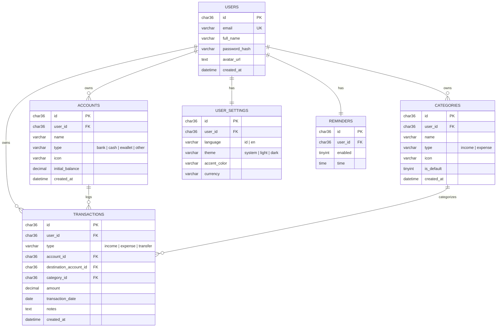

<div align="center">

  

  <p align="center">
    <strong>Aplikasi Pencatatan Keuangan Pribadi Modern, Cepat, dan Elegan</strong>
  </p>

  <p align="center">
    <a href="#-fitur-utama">Fitur</a> •
    <a href="#-tech-stack">Tech Stack</a> •
    <a href="#-panduan-instalasi--menjalankan-lokal">Instalasi</a> •
    <a href="#-deployment-vercel--tidb-cloud">Deployment</a> •
    <a href="#-skema-database-mysql">Database</a> •
    <a href="#-struktur-folder-proyek">Struktur</a>
  </p>

  <p align="center">
    
    
    
    
    
    
    
  </p>

</div>

---

## 📖 Tentang Fintracks

**Fintracks** adalah aplikasi web pencatatan keuangan pribadi (*personal finance tracker*) berbasis **React + TypeScript** di frontend dan **Node.js + Express.js + MySQL** di backend. Dirancang dengan pendekatan *mobile-first*, performa tinggi, serta tampilan bersih untuk mencatat arus kas harian, mengelola multi-rekening, dan memantau kesehatan finansial melalui visualisasi analitik interaktif.

---

## ✨ Fitur Utama

### 1. 💵 Pencatatan Transaksi Cerdas
- **Tipe Transaksi Lengkap:** Mendukung *Pemasukan (+)*, *Pengeluaran (-)*, dan *Transfer Internal (↔)* antar rekening.
- **Smart Validation:** Otomatis memvalidasi ketersediaan saldo sebelum pengeluaran atau transfer diproses.
- **Format Otomatis Rupiah:** Input nominal cerdas terformat langsung (*misal `50.000` tersimpan presisi `50000`*).
- **Pengelompokan Tanggal:** Riwayat transaksi dikelompokkan rapi per tanggal (*Hari Ini*, *Kemarin*, atau tanggal ringkas).
- **Filter Periode Lengkap:**
  - 📅 **Hari Ini**
  - 📅 **Kemarin**
  - 📅 **7 Hari Terakhir**
  - 📅 **Bulan Ini** *(dengan navigasi bulan)*
  - 📅 **Tahun Ini** *(dengan navigasi tahun)*
  - 📅 **Custom Date Range** *(bebas tentukan tanggal awal & akhir)*

### 2. 🏦 Manajemen Multi-Rekening
- Kelola berbagai jenis rekening: **Bank**, **Tunai**, **E-Wallet**, dan **Lainnya**.
- **Dynamic Balance Calculation:** Saldo dihitung *real-time* dari riwayat mutasi transaksi dan saldo awal langsung melalui query SQL.
- **Proteksi Data:** Mencegah penghapusan rekening yang masih memiliki riwayat transaksi aktif.
- **Halaman Detail Rekening:** Menampilkan mutasi khusus rekening tersebut beserta statistik pemasukan & pengeluaran bulanan.

### 3. 📊 Rekap & Analitik Keuangan
- **Kartu Ringkasan:** Indikator jelas untuk *Total Pemasukan*, *Total Pengeluaran*, dan *Selisih* (*Net Cashflow*).
- **Donut Chart Interaktif (Recharts):** Visualisasi proporsi pengeluaran dan pemasukan per kategori.
- **Rincian Per Kategori:** Daftar persentase kontribusi dan nominal terformat untuk setiap kategori.

### 4. 🏷️ Kategori Kustom Dinamis
- Kategori bawaan otomatis dibuat untuk setiap akun baru.
- Tambah, edit nama, dan pilih ikon emoji kustom untuk kategori pemasukan maupun pengeluaran.

### 5. 🌓 Desain Modern (Emerald & Charcoal Dark)
- **Tema Terang & Gelap:** Warna *Charcoal Dark* (`#0d0f12`) dipadukan dengan aksen *Emerald Green* (`#064e3b`) dan *Mint* (`#5eead4` / `#86efac`).
- **Layout Responsif:** Optimal di mobile (*bottom navigation* + *bottom sheet*) maupun desktop (*top navbar*).

### 6. 🌐 Multi-Bahasa (i18n) & Pengingat
- Pilihan bahasa: **Bahasa Indonesia** *(default)* dan **English**.
- **Notifikasi Pengingat Harian:** Menggunakan *Browser Notifications API* pada jam yang dapat disesuaikan.

### 7. 🔐 Autentikasi, Keamanan & Backup Data
- **Email & Password + JWT:** Registrasi dan login aman dengan password ter-hash (`bcryptjs`) serta token JWT.
- **Isolasi Data Per Akun:** Seluruh endpoint API memvalidasi kepemilikan `user_id` di tingkat backend & query SQL.
- **Backup & Restore JSON:** Unduh salinan seluruh data (`fintracks-backup-YYYY-MM-DD.json`) dan pulihkan kapan saja dengan pemetaan ID otomatis.
- **Hapus Semua Data:** Reset seluruh transaksi, rekening, dan kategori kustom dari halaman Pengaturan.

### 8. 📲 Progressive Web App (PWA)
- Dapat diinstal (*installable*) di perangkat mobile maupun desktop dengan dukungan *Service Worker* dan *Web App Manifest*.

---

## 🚀 Tech Stack

| Komponen | Teknologi | Deskripsi |
|---|---|---|
| **Frontend** | [React 19](https://react.dev/) + [TypeScript](https://www.typescriptlang.org/) | UI modern dengan type-safety |
| **Build Tool** | [Vite](https://vite.dev/) | Bundler cepat dengan HMR |
| **Styling** | [Tailwind CSS v4](https://tailwindcss.com/) + CSS Variables | Token desain terang/gelap & responsif |
| **Backend** | [Node.js](https://nodejs.org/) + [Express.js 5](https://expressjs.com/) | REST API & autentikasi JWT (`Fintracks-backend/`) |
| **Database** | [MySQL 8](https://www.mysql.com/) / [TiDB Cloud](https://tidbcloud.com/) | Penyimpanan relasional dengan `mysql2` & SSL |
| **Charts & Icons** | [Recharts](https://recharts.org/) & [Lucide React](https://lucide.dev/) | Grafik donat interaktif & ikon vektor |
| **PWA** | [Vite Plugin PWA](https://vite-pwa-org.netlify.app/) | Service Worker & instalasi aplikasi |

---

## 🛠️ Panduan Instalasi & Menjalankan Lokal

### 1. Prasyarat
- **Node.js** (versi 18+)
- **MySQL 8** lokal atau database **TiDB Cloud** (MySQL-compatible)

### 2. Clone Repositori
```bash
git clone https://github.com/dappahsn/Fintracks.git
cd Fintracks
```

### 3. Setup & Jalankan Backend (`Fintracks-backend`)
```bash
cd Fintracks-backend
npm install
cp .env.example .env
```
Sesuaikan konfigurasi database dan `JWT_SECRET` pada `Fintracks-backend/.env`:
```env
PORT=4000
CORS_ORIGIN=http://localhost:5173
DB_HOST=localhost
DB_PORT=3306
DB_NAME=fintracks
DB_USER=root
DB_PASSWORD=password_mysql_anda
DB_SSL=false
JWT_SECRET=ganti-dengan-secret-aman
```
Jalankan migrasi tabel dan nyalakan server backend:
```bash
npm run db:migrate
npm run dev
```
Backend akan berjalan di `http://localhost:4000` (cek `http://localhost:4000/api/health`).

### 4. Setup & Jalankan Frontend (`Fintracks`)
Buka terminal baru di root folder `Fintracks`:
```bash
npm install
cp .env.example .env
```
Pastikan isi `.env` frontend:
```env
VITE_API_URL=http://localhost:4000/api
```
Jalankan frontend:
```bash
npm run dev
```
Buka `http://localhost:5173` di browser.

---

## ☁️ Deployment (Vercel + TiDB Cloud)

1. **Database (TiDB Cloud):**
   - Buat cluster **Starter (MySQL Compatible)** dan jalankan skema dari [Fintracks-backend/sql/001_initial_schema.sql](Fintracks-backend/sql/001_initial_schema.sql).
2. **Backend di Vercel (`fintracks-api`):**
   - Import repo `dappahsn/Fintracks` dengan **Root Directory:** `Fintracks-backend` dan **Application Preset:** `Express`.
   - Isi Environment Variables: `DB_HOST`, `DB_PORT` (`4000`), `DB_NAME` (`fintracks`), `DB_USER`, `DB_PASSWORD`, `DB_SSL` (`true`), `JWT_SECRET`, dan `CORS_ORIGIN`.
3. **Frontend di Vercel (`fintracks`):**
   - Import repo `dappahsn/Fintracks` dengan **Root Directory:** `./` dan **Application Preset:** `Vite`.
   - Isi Environment Variable: `VITE_API_URL=https://<domain-backend-vercel>/api`.
   - Setelah URL frontend aktif, perbarui `CORS_ORIGIN` di project backend menjadi URL frontend tersebut lalu *Redeploy*.

---

## 🗄️ Skema Database (MySQL)

Skema lengkap tersedia di [Fintracks-backend/sql/001_initial_schema.sql](Fintracks-backend/sql/001_initial_schema.sql):



---

## 📁 Struktur Folder Proyek

```
Fintracks/
├── Fintracks-backend/          # Backend Express.js + MySQL
│   ├── api/                    # Entrypoint serverless Vercel
│   ├── sql/                    # Skema SQL MySQL
│   └── src/
│       ├── config/             # Konfigurasi env & SSL
│       ├── constants/          # Data default kategori & user
│       ├── db/                 # Pool mysql2 & script migrasi
│       ├── middleware/         # JWT auth & error handler
│       ├── routes/             # REST API routes
│       ├── app.js              # Konfigurasi Express app
│       └── server.js           # Entrypoint server lokal
├── public/
│   └── icons/                  # Logo & favicon aplikasi
├── src/
│   ├── components/             # Komponen UI modular
│   │   ├── accounts/           # Form & kartu rekening
│   │   ├── auth/               # Route protection
│   │   ├── categories/         # Form kategori
│   │   ├── navigation/         # Topbar desktop & bottom nav mobile
│   │   ├── recap/              # Donut chart & summary cards
│   │   ├── transactions/       # List, item, filter bar, & form transaksi
│   │   └── ui/                 # Reusable UI (Button, Input, Modal, dll.)
│   ├── contexts/               # React Context (Auth, Theme, I18n, Toast)
│   ├── layouts/                # AppLayout & AuthLayout
│   ├── lib/                    # HTTP API client & konstanta
│   ├── locales/                # Multi-bahasa (ID & EN)
│   ├── pages/                  # Halaman aplikasi
│   ├── services/               # Integrasi REST API backend
│   ├── types/                  # Definisi TypeScript
│   ├── utils/                  # Format mata uang, tanggal, & validasi
│   ├── App.tsx                 # Routing aplikasi
│   ├── index.css               # Sistem tema & Tailwind CSS v4
│   └── main.tsx                # Entry point
├── index.html
├── package.json
├── vercel.json
└── vite.config.ts
```

---

## 📄 Lisensi

Didistribusikan di bawah Lisensi MIT.

---

<div align="center">
  Dibuat dengan ❤️ untuk kemudahan pengelolaan keuangan pribadi Anda.
</div>
